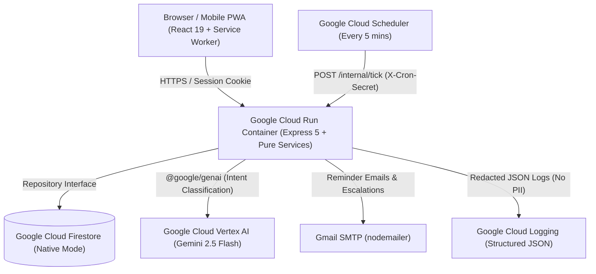

# Haamika — Technical Architecture

> *Haami aapki, fikar hamari* — Your yes, our care.

Haamika is an interconnected elderly care and medication management platform designed for Cloud Run. It combines a deterministic Node.js backend with an accessible React 19 Progressive Web Application (PWA).

---

## 1. System Topology



---

## 2. Layered Architecture

```
src/
├── shared/             # Shared types, Zod schemas, slot calculations, and link builders
│   ├── schemas.ts      # Single source of truth for runtime validation (Zod)
│   ├── types.ts        # TypeScript domain models
│   └── whatsappLink.ts # Safe WhatsApp URL generator
├── server/
│   ├── config.ts       # Validated environment configuration (fail-fast)
│   ├── app.ts          # Express 5 application factory with middleware stack
│   ├── middleware/     # Security, rate limiting, session, role authorization
│   ├── repositories/   # Abstract Repository interface + Memory & Firestore implementations
│   ├── routes/         # Circle-scoped REST APIs (auth, medicines, proposals, schedule, etc.)
│   └── services/       # Pure domain services (scheduleEngine, adherence, reminderEngine, voiceIntent)
└── web/
    ├── styles/         # Plain CSS variables with high-contrast accessibility themes
    ├── i18n/           # English and Hindi (Devanagari) dictionaries
    ├── components/     # Accessible UI components (PinPad, PillIcon, BarChart, SosModal, VoiceModal)
    ├── views/          # Role-tailored views (Landing, SignIn, ElderHome, FamilyDashboard, Caretaker)
    └── api/client.ts   # Cookie-authenticated fetch client with offline queue
```

---

## 3. Pure Services & Deterministic Core

All business rules live as **pure functions** in `src/server/services/` with zero database or network I/O:
- **Schedule Engine (`scheduleEngine.ts`)**: Calculates anchor-based dose windows (`[anchor - 30m, anchor + 120m]`), statuses (`pending`, `taken`, `taken_late`, `skipped`, `missed`), and deterministic event IDs (`{date}_{slot}_{itemType}_{itemId}`).
- **Adherence & Insights (`adherence.ts`, `insights.ts`)**: Calculates 7-day and 30-day adherence rates; identifies recurring miss patterns (e.g., ≥ 3 night misses in 7 days).
- **Reminder Engine (`reminderEngine.ts`)**: Determines which email reminders (`dose_upcoming`, `dose_missed`, `dose_missed_escalation`, `appointment_upcoming`, `refill_low`) are due at any timestamp, generating member-scoped dedupe keys (`{circleId}:{kind}:{target}:{date}:{stage}:{memberId}`) and dual-timezone displays.
- **Voice Classifier & Safety Guard (`voiceIntent.ts`, `emergency.ts`)**: Code-first emergency detection; strictly rejects voice-directed medicine modifications or dosing advice; requires explicit confirmation for state mutations.

---

## 4. Google Cloud Services Mapping

| Google Service | Role in Haamika | Primary Source File |
| :--- | :--- | :--- |
| **Cloud Run** | Unified container hosting Express API and compiled static React PWA | [Dockerfile](file:///C:/Projects/Haamika/Dockerfile), [index.ts](file:///C:/Projects/Haamika/src/server/index.ts) |
| **Cloud Firestore** | Server-side persistence with circle-isolated collections and strict access rules | [firestoreRepository.ts](file:///C:/Projects/Haamika/src/server/repositories/firestoreRepository.ts), [firestore.rules](file:///C:/Projects/Haamika/firestore.rules) |
| **Vertex AI (Gemini)** | Structured JSON intent classification for voice transcripts (`@google/genai`) | [geminiClient.ts](file:///C:/Projects/Haamika/src/server/services/geminiClient.ts) |
| **Cloud Scheduler** | Invokes `POST /internal/tick` every 5 minutes to trigger reminder evaluation | [internal.ts](file:///C:/Projects/Haamika/src/server/routes/internal.ts) |
| **Cloud Logging** | Structured JSON logs scrubbed of all PII, health details, and credentials | [logger.ts](file:///C:/Projects/Haamika/src/server/services/logger.ts) |
| **Google Calendar** | Direct web intent URL generator for doctor appointments | [calendarLink.ts](file:///C:/Projects/Haamika/src/server/services/calendarLink.ts) |
