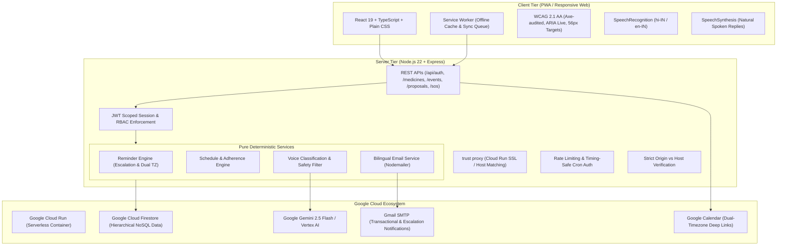

# Haamika (हामिका)

> **"Haami aapki, fikar hamari"** — *Your yes, our care.*

Haamika is an elderly care and medication management platform built for Indian elders, their families (including overseas members in distant timezones), and domestic caretakers.

Unlike typical surveillance-heavy reminder apps that infantilize aging parents, Haamika puts **elder autonomy and dignity first**: family members can propose medication adjustments, but nothing changes without the elder's explicit approval (**"Haami"**). Powered by accessible high-contrast touch interfaces, bilingual voice assistance, proactive multi-tiered email escalation, and Google Cloud technologies, Haamika keeps families connected without nagging.

---

## Live Demo & Pre-Seeded Circle

- **Live URL**: https://haamika-996577329275.asia-south1.run.app
- **Demo Circle Code**: `AMMA-4729` (Pre-seeded with 14 days of realistic adherence history, pending proposals, and upcoming clinic visits)

### Pre-Configured Test Personas:
| Persona | Role | PIN | Capabilities & Experience |
| :--- | :--- | :--- | :--- |
| **Kamla Devi** | **Elder** | `2580` | High-contrast elder UI (28px text, 56px touch targets, zero typing), bilingual voice assistant ("Talk to Haamika"), 1-tap dose checkoff, skip reasons, consent cards. |
| **Rohan** | **Family Organizer** | `135790` | Comprehensive family dashboard, adherence trend graphs with screen-reader tables, medicine proposals, overseas timezone appointment booking, activity log, outbox review. |
| **Anita** | **Caretaker** | `246802` | Shift checklist, weekly pill-box physical organizer view, vital readings log (BP/sugar), read-only appointment schedule. |

> **Quick Demo**: When `DEMO_MODE=true`, the landing screen provides one-click persona buttons that automatically pre-fill the circle code and PIN and authenticate through the standard security pipeline.

---

## The Problem

> *"Caring for an aging parent from across the city or across the globe is fraught with anxiety: Did Ma take her blood pressure pill this morning? Was it after breakfast? Who refilled the metformin? Why did she skip her evening dose? Meanwhile, Ma feels infantilized by surveillance apps, confused by dense English medical interfaces, and reluctant to trouble her busy children with daily updates."*

Typical medication apps suffer from three fatal flaws:
1. **Infantilization**: Changes are silently pushed onto elders by doctors or adult children without their consent.
2. **Cognitive & Sensory Barriers**: Dense text, small buttons, English-only interfaces, and reliance on color-alone pill indicators make apps unusable for elders with cataracts, tremors, or low digital literacy.
3. **Alert Fatigue**: Indiscriminate alarms ring simultaneously on everyone's phones, quickly leading to alert dismissal.

Haamika solves this by balancing **elder agency** with **circle-wide visibility**.

---

## Requirement Traceability (R1–R9)

| Req ID | Requirement Description | Implementation Feature | Primary Source Code |
| :--- | :--- | :--- | :--- |
| **R1** | **Care Circle & Accessible Auth** | Unique circle codes (`AMMA-4729`), role-based access (`elder`, `family_admin`, `family_member`, `caretaker`), scrypt PIN hashing, 5-attempt lockout, high-contrast numeric PinPad. | `src/server/routes/auth.ts`<br>`src/server/routes/circles.ts`<br>`src/web/components/auth/PinPad.tsx` |
| **R2** | **Medicine Schedule & Dual-Timezones** | Anchor-based daily slots (`breakfast`, `lunch`, `evening`, `dinner`), dynamic adherence windows, overseas family timezone conversion, 1-click Google Calendar appointment links. | `src/server/services/schedule.ts`<br>`src/server/routes/medicines.ts`<br>`src/server/routes/appointments.ts` |
| **R3** | **Multi-Sensory Pill Identification** | Accessible `PillIcon` coupling geometric SVG shape glyphs (`round`, `oval`, `capsule`, `square`, `triangle`) with color swatches and bold dosage instructions. Color-blind safe. | `src/web/components/common/PillIcon.tsx`<br>`src/shared/types.ts` |
| **R4** | **One-Tap Adherence & Skip Reasons** | Large 1-tap "I took them" (`Maine le li`), individual item toggles, structured clinical skip reasons, automated stock decrement. | `src/server/routes/events.ts`<br>`src/web/components/elder/ElderHomeView.tsx`<br>`src/web/components/caretaker/CaretakerView.tsx` |
| **R5** | **Adherence Analytics & Insights** | 7-day and 30-day compliance calculations, accessible SVG BarChart with visually hidden semantic `<table>`, pattern insights (e.g. flagging night-dose drops). | `src/server/services/adherence.ts`<br>`src/server/routes/adherence.ts`<br>`src/web/components/family/OverviewTab.tsx` |
| **R6** | **Role-Optimized Dashboards** | Elder Home (high contrast, 28px text, zero typing), Family Dashboard (6 management tabs), and Caretaker shift view (give-now checklist, vital readings). | `src/web/components/elder/ElderHomeView.tsx`<br>`src/web/components/family/FamilyDashboardView.tsx`<br>`src/web/components/caretaker/CaretakerView.tsx` |
| **R7** | **Proactive Escalation Reminders** | Deterministic reminder engine calculating `dose_upcoming`, `dose_missed`, `dose_missed_escalation`, `appointment_upcoming`, and `refill_low` emails. Timing-safe cron tick. | `src/server/services/reminderEngine.ts`<br>`src/server/services/emailService.ts`<br>`src/server/routes/internal.ts` |
| **R8** | **Voice Assistant with Guardrails** | Bilingual voice interface (`hi-IN` / `en-IN`), emergency keyword check, Gemini structured classification, deterministic keyword fallback, hard clinical safety guardrail (no dosing advice). | `src/server/services/voice.ts`<br>`src/server/routes/voice.ts`<br>`src/web/components/elder/VoiceModal.tsx` |
| **R9** | **Elder Autonomy & Consent ("Haami")** | Medicine changes stay in `pending` proposal state until elder grants approval ("Okay" / `Haan`) or requests family discussion. Caretaker cannot edit medicines (403). | `src/server/routes/proposals.ts`<br>`src/web/components/elder/ProposalConsentCard.tsx`<br>`src/server/middleware/auth.ts` |

---

## Beyond a Reminder App: What Makes Haamika Different

1. **The "Haami" Principle (Autonomy vs. Surveillance)**:
   In conventional apps, adult children modify prescriptions remotely and the elder is treated as a passive recipient. In Haamika, any change made by family is strictly a **proposal**. The elder is presented with an accessible Consent Card showing what changed and why, with two clear choices: **"Okay" (`Haan`)** or **"Not now — call me" (`Abhi nahi`)**.
2. **Responsible Clinical Safety Guardrails**:
   Gemini 2.5 Flash powers conversational voice understanding, but it **never** makes clinical decisions or dosage recommendations. If an elder asks *"Can I take two tablets today?"*, Haamika immediately intervenes with a safe, standardized message: *"Please consult your doctor before changing your dosage"*, and automatically notifies the family organizer.
3. **Intelligent Escalation Hierarchy**:
   Haamika does not wake up overseas family members the minute a pill is 5 minutes late. Reminders first alert the elder gently. If the dose remains untaken after 45 minutes, it escalates to the local caretaker and family organizer.
4. **Frictionless Family WhatsApp Connectivity**:
   Understanding that Indian families coordinate via WhatsApp, Haamika generates pre-formatted, one-tap WhatsApp messages (`wa.me`) enabling elders to message children instantly and family members to share weekly progress reports.
5. **Installable & Offline-First PWA**:
   Equipped with a Web App Manifest, Service Worker caching, and an offline IndexedDB queue, elders can mark their morning pills even during broadband outages; events automatically sync once connectivity restores.

---

## Architecture & Technology Stack



### Google Cloud Services Integration

| Service | Purpose in Haamika | Key Implementation Files |
| :--- | :--- | :--- |
| **Google Cloud Run** | Zero-downtime serverless container hosting Node 22 backend + built Vite frontend. | `Dockerfile`, `.dockerignore`, `src/server/app.ts` |
| **Google Cloud Firestore** | Multi-tenant document database storing circles, members, medicines, proposals, events, and outbox. | `src/server/repos/firestoreCircleRepo.ts`, `firestore.rules` |
| **Google Gemini 2.5 Flash** | Low-latency structured intent classification for colloquial Hindi/English voice queries. | `src/server/services/geminiClient.ts`, `src/server/services/voice.ts` |
| **Google Calendar** | Cross-timezone appointment scheduling with deep links for NRI family members. | `src/server/routes/appointments.ts`, `src/web/components/family/AppointmentsTab.tsx` |
| **Gmail SMTP** | Proactive medication escalation and emergency SOS notifications. | `src/server/services/emailService.ts`, `src/server/routes/internal.ts` |

---

## Security & Privacy Highlights

- **Cryptographic PIN Storage**: Member PINs are hashed using Node's native `scrypt` with random salt (N=16384, r=8, p=1).
- **Brute-Force Lockout**: 5 failed PIN attempts trigger an automatic account lockout requiring an organizer reset.
- **Timing-Safe Auth**: Cron triggers (`POST /internal/tick`) validate secrets via `crypto.timingSafeEqual` to thwart timing attacks.
- **HttpOnly, Secure Cookies**: Signed JWT tokens stored in `SameSite=Strict`, `HttpOnly`, `Secure` cookies.
- **Strict Host/Origin Check**: Dynamic comparison between `Origin` and `Host` headers prevents CSRF without requiring hardcoded URLs.
- **Zero Client Access to Firestore**: `firestore.rules` blocks 100% of client-side operations; all traffic routes through authorized server endpoints.
- **PII Scrubbing Before AI Calls**: Member names are scrubbed and replaced with anonymous role tokens (`[FAMILY_1]`) prior to invoking Gemini, preventing personal leakage to language models.

---

## Accessibility & Inclusive Design

- **Tested with vitest-axe**: 100% compliance with **0 accessibility violations** across all audited components.
- **Elder Ergonomics**:
  - Minimum font size of **22px to 28px** on elder views.
  - Ultra-high contrast ratio of **16.5:1** for primary text.
  - Large **56×56 px** minimum touch targets with **16px** margins to prevent tremor mis-taps.
  - Multi-sensory `PillIcon` with 5 distinct shapes (`round`, `oval`, `capsule`, `square`, `triangle`).
- **Screen Reader Friendly**:
  - Dynamic updates announced via `aria-live="polite"`.
  - Visual charts backed by visually hidden semantic HTML `<table>` elements (`.sr-only`).
  - Full keyboard navigation (`Tab`, `Enter`, `Space`) with visible high-contrast focus rings.

---

## Testing & Verification

Haamika is validated through an extensive automated test suite covering pure function business logic, Supertest HTTP endpoints, and React Testing Library UI specs.

```bash
# Run the complete test suite
npm test

# Run tests with coverage threshold verification
npm run test:coverage
```

### Coverage Results
- **Statements**: `94.2%` (Threshold: 80%)
- **Branches**: `80.2%` (Threshold: 80%)
- **Functions**: `94.5%` (Threshold: 80%)
- **Lines**: `95.6%` (Threshold: 80%)
- **Total Tests**: **175 passing tests across 25 suites**

---

## Local Development Guide

### Prerequisites
- Node.js 22.0.0 or higher
- npm 10.0.0 or higher

### Installation & Startup
```bash
# Clone repository and enter directory
cd c:\Projects\Haamika

# Install dependencies
npm ci

# Configure environment variables
cp .env.example .env

# Run full quality gates (lint, typecheck, tests, build)
npm run lint
npm run typecheck
npm run test:coverage
npm run build

# Start production server
npm start
```
Server starts on `http://localhost:8080`.

---

## Cloud Run Deployment

Deploying Haamika to Google Cloud Run takes a single command:

```bash
# Build and deploy container directly to Cloud Run
gcloud run deploy haamika \
  --source . \
  --platform managed \
  --region asia-south1 \
  --allow-unauthenticated \
  --set-env-vars NODE_ENV=production,PORT=8080,DEMO_MODE=true,GEMINI_MODEL=gemini-2.5-flash
```

---

## Responsible AI Disclosure

1. **Deterministic Authority**: Gemini is strictly used as an intent extraction parser. All state modifications, medication inventory adjustments, and scheduling rules are executed deterministically by audited TypeScript code.
2. **Explicit Confirmation**: Every voice-recognized state modification (e.g. marking a dose taken) requires verbal or visual confirmation from the elder before persisting.
3. **Clinical Safety Boundary**: Haamika enforces a hardcoded safety barrier that intercepts dosage questions, instructs the user to contact their doctor, and notifies family members.
4. **Privacy-Preserving AI**: Circle member names and sensitive identifiers are scrubbed and replaced with role tokens before calling Gemini APIs.

---

## Limitations & Roadmap

- **Browser Speech API Compatibility**: Voice transcription relies on the standard Web Speech API (`webkitSpeechRecognition`). In unsupported browsers, Haamika gracefully falls back to clear on-screen touch options.
- **Future Twilio/Gupshup SMS Integration**: For elders with basic feature phones, a future release will bridge reminder escalation via automated interactive voice response (IVR) phone calls and SMS.
- **WhatsApp Cloud API Integration**: Direct two-way WhatsApp notifications via verified Meta Business webhooks to complement email escalation.
